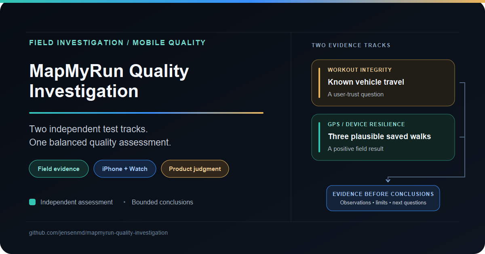
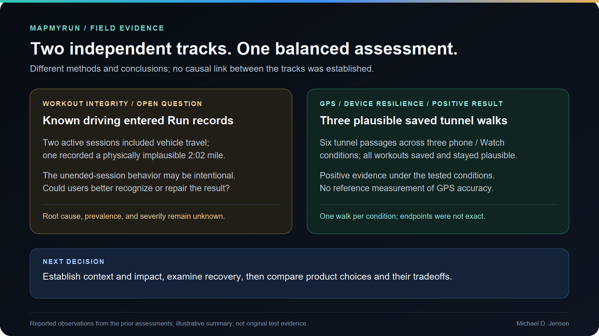
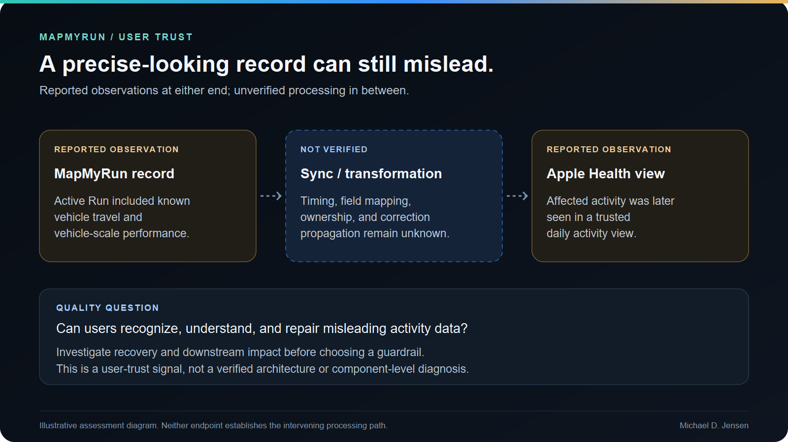

# MapMyRun Quality Investigation

A weekend field investigation of workout-record integrity and GPS resilience. I used an application question as the starting point, tested what I could with personal devices and nearby terrain, and separated the findings from the explanations I could not yet prove.

**Michael D. Jensen** · Independent QA investigation · August 2026

[Assessment brief](Michael_Jensen_MapMyRun_Weekend_Quality_Assessment.pdf) · [Detailed assessment](Michael_Jensen_MapMyRun_Senior_QE_Assessment.pdf) · [Accessible text and recorded measurements](docs/assessment.md)

## The Challenge

While applying for a role at Outside supporting MapMyFitness, I encountered a question I recall as: **“What are the biggest quality issues with MapMyRun currently?”** The original application text is not archived here, so that is recalled wording.

I wanted to answer with something I had actually investigated. I had a weekend, an iPhone, an Apple Watch, and the tunnels on nearby Gold Camp Road in Colorado Springs. I used MapMyRun as an ordinary customer, followed an unexpected observation, and exercised recording under different device conditions.

That access could support a focused investigation; it could not establish the product’s biggest issues. The value of the work is in choosing useful questions, reporting what held up, and knowing where the evidence stops. This is independent work, with no affiliation or endorsement implied.

## What I Investigated

| Track | What I did | What was reported |
| --- | --- | --- |
| **Workout-record integrity** | Followed an accidental unended Run session with a deliberate pedestrian-to-vehicle follow-up | Two Run records included known vehicle travel and vehicle-scale performance; one contained a 2:02 mile |
| **GPS and device resilience** | Walked through Gold Camp Road Tunnel #1 and back under three phone / Watch conditions | All three workouts saved and remained physically plausible across six tunnel passages |

The tracks are independent. The tunnel walks do not explain the vehicle-transition records, and the workout-integrity concern does not erase the positive resilience result.

### Workout-record integrity: a user-trust question

Leaving a Run active during known driving produced misleading workout performance. The follow-up again included vehicle travel; Auto-Pause was on and a paused state was observed, but the complete state sequence was not reconstructed.

Recording movement until a user ends a session may be intentional. I did not establish a violated requirement or a faulty component. The useful question is whether users can recognize, understand, and repair the result of a foreseeable mistake. The existing recovery workflow needs a fuller assessment before recommending a feature.

Affected activity was later observed in an Apple Health daily view. That supports a downstream user-trust concern, but it does not establish the synchronization timing, field transformations, responsible component, or wider impact.

### GPS and device resilience: a positive field result

Each tunnel walk began in open air, crossed Tunnel #1, continued beyond it, reversed, and crossed back:

1. **GC-01:** iPhone-started; phone carried; Apple Watch worn.
2. **GC-02:** Watch-started; powered-on phone left at the start.
3. **GC-03:** Watch-started; phone powered off and left at the start.

The reports describe transient GPS noise but plausible saved results in all three conditions. Reported average pace stayed near 20 minutes per mile. The 0.91–1.07 mile distance spread is not evidence of a defect by itself: durations and exact execution lengths varied. There was one walk per condition, no reference measurement of distance accuracy, and no raw-sample analysis to establish sensor ownership or a fallback mechanism.

## The Quality Judgment

**A product can record movement as intended and still leave a user with a misleading result.** Whether that deserves prevention, a warning, better recovery, or no change depends on evidence about prevalence, impact, existing behavior, and tradeoffs.

This investigation supports a positive resilience finding and further inquiry into workout integrity. It does not establish root cause, production severity, population frequency, or the best intervention. False positives, accessibility, privacy, battery use, and implementation cost belong in the decision.

## What I Would Do Next

- **Explore recovery:** can a user identify, trim, relabel, or otherwise correct the affected workout?
- **Check downstream correction:** does correcting the workout change what appears in Apple Health?
- **Establish importance:** what evidence about repeatability, user impact, and existing recovery would justify treating this as a significant quality issue?

These are proposed follow-up checks, not work completed during the weekend. Their results should guide any discussion of product changes; the positive Gold Camp results remain a separate baseline.

## Evidence, Reports, and Revision History

The original assessments date field work **August 22–23, 2026** and an interpretation revision **August 30**. The measurements here are transcribed from those assessments. Original workout screenshots, field notes, raw sensor samples, and version records are not archived in this repository; the reports are the retained record, not a reproducible raw dataset.

| Read | Purpose |
| --- | --- |
| [Assessment brief — PDF](Michael_Jensen_MapMyRun_Weekend_Quality_Assessment.pdf) / [text](docs/brief.md) | Short findings, limits, and next decisions |
| [Detailed assessment — PDF](Michael_Jensen_MapMyRun_Senior_QE_Assessment.pdf) / [text](docs/assessment.md) | Methods, record IDs, measurements, interpretations, and engineering questions |
| [Revision notes](docs/revision-notes.md) | What changed in the presentation and where the retained measurements came from |
| [Visual system and regeneration](assets/README.md) | Editable graphics, report sources, and the investigation design variant |

The initial narrative connected the two tracks too tightly. Review separated their methods and conclusions. This October presentation refactor makes that reasoning easier to follow; it adds no new field tests or stronger claims about the observations.

## What This Demonstrates

Exploratory testing, mobile field-test design, cross-metric reasoning, product-risk analysis, and clear technical communication. The work includes reporting favorable results, challenging an attractive explanation, and improving the interpretation when the evidence calls for it.

AI assisted research, experiment planning, evidence organization, drafting, and visual production. I performed the field work, challenged unsupported connections, and retained ownership of the observations and judgments.

---

## QA Portfolio Quick Reference

See [Michael D. Jensen’s QA portfolio](https://github.com/jensenmd) for the complete project overview.

| Project | Purpose and Approach |
| --- | --- |
| [fhir-api-qa](https://github.com/jensenmd/fhir-api-qa) | Checks whether a healthcare API preserves Patient data through its lifecycle, with isolated FHIR tests and useful CI failure evidence. |
| [pharmacy-spend-etl-qa](https://github.com/jensenmd/pharmacy-spend-etl-qa) | Checks that pharmacy spend data survives the trip from source files to analytics tables, using SQL reconciliation on a synthetic pipeline. |
| [restful-booker-qa](https://github.com/jensenmd/restful-booker-qa) | Tests booking behavior at both API and browser layers, combining Postman/Newman and Playwright for repeatable regression feedback. |
| [qa-automation-showcase](https://github.com/jensenmd/qa-automation-showcase) | Examines API behavior and the quality of returned data together, using pytest, Postman, and Python validation. |
| [android-appium-wdio-poc](https://github.com/jensenmd/android-appium-wdio-poc) | Builds a focused baseline for Android UI checks, exercising Settings navigation on a local emulator with Appium and WebdriverIO. |
| [mapmyrun-quality-investigation](https://github.com/jensenmd/mapmyrun-quality-investigation) **(this repository)** | Investigates how workout tracking affects data integrity and user trust, using mobile field experiments and separating observations from explanations. |
| [ai-qa-framework](https://github.com/jensenmd/ai-qa-framework) | Explores how AI can help develop useful API test coverage while keeping a QA engineer responsible for review and pytest execution. |
| [claude-code-qa-sessions](https://github.com/jensenmd/claude-code-qa-sessions) | Shows how human QA judgment guides Claude Code from finding coverage gaps to making targeted, reviewed test improvements. |
| [agentqa-orchestrator](https://github.com/jensenmd/agentqa-orchestrator) | Explores inspectable AI code reviews, using Gemini and Pydantic-defined response schemas to produce structured JSON audit artifacts. |

---

## Author

**Michael D. Jensen** — Senior QA Engineer 
15+ years of enterprise software testing experience across healthcare IT, financial systems, telecommunications, and cybersecurity. Deep background in REST API validation, SQL-based data integrity verification, exploratory testing, and quality ownership in complex systems.

Current hands-on work includes Python/pytest automation, Playwright and Appium projects, CI/CD-integrated quality practices, and practical AI-assisted QA workflows.

🔗 [LinkedIn](https://www.linkedin.com/in/michaeljensen-qa/) | 🐙 [GitHub Profile](https://github.com/jensenmd) | 📧 jensen.md@gmail.com
